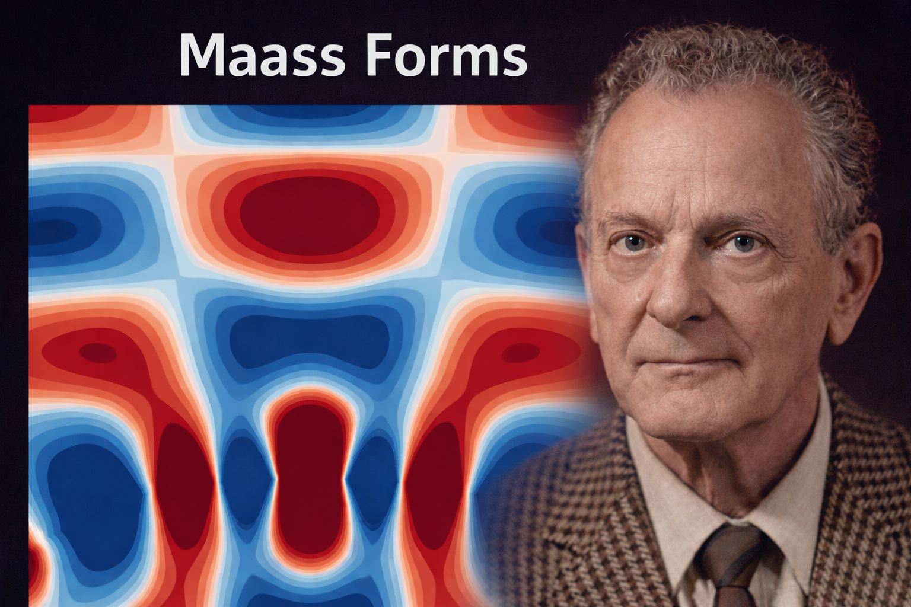

# Maass Forms — Spectral Geometry Under Extreme Constraints



## What are Maass forms — and why do they still matter?

In the 1940s, **Hans Maass** introduced a radical shift in mathematical thinking.

Instead of focusing on explicit formulas, he proposed studying the **natural vibration modes** of highly symmetric spaces — much like standing waves on a drum, but living on curved, arithmetic geometry.

These objects are now called **Maass forms**.

They are not designed.
They are not tuned.
They **survive**.

This repository is a small, from-scratch **computational reflection** of that spectral idea.

---

## Conceptual overview (no number theory required)

A Maass cusp form is best understood as an **eigenmode under extreme constraints**:

- 🌀 It lives on **curved (hyperbolic) space**
- ♻️ It is invariant under **rigid arithmetic symmetries** (the modular group)
- 🎼 It exists only at **very specific frequencies** (eigenvalues)

Most candidate functions are destroyed by these constraints.

A few survive — not because we choose them, but because **geometry and symmetry leave no alternative**.

---

## What this project does (and what it does not)

### ✅ What it does

- Implements a **Hejhal-style truncated reconstruction** of Maass cusp forms
- Searches spectrally for **even and odd eigenmodes**
- Enforces modular symmetry, cusp decay, and Laplacian eigenstructure
- Produces **visual, interpretable plots** of the resulting eigenfunctions

### ❌ What it does *not* do

- ❌ No closed-form formulas
- ❌ No certified eigenvalues
- ❌ No high-precision arithmetic claims
- ❌ No reliance on specialized Maass-form libraries

---

## How the pipeline works (high level)

1. **Basis construction**  
   Truncated Fourier–Bessel expansions using  
   √y·Kᵢʳ(2πny)·cos(2πnx) (even)  
   or  
   √y·Kᵢʳ(2πny)·sin(2πnx) (odd)

2. **Symmetry enforcement**  
   Enforce modular invariance by comparing f(z) and f(−1/z)

3. **Spectral search**  
   Scan over spectral parameter r and locate minima of the smallest singular value

4. **Refinement**  
   Increase precision and extract the surviving eigenmode

5. **Visualization**  
   Render the function on a fixed, interpretable window

---

## Running the code

### Requirements

```bash
pip install numpy mpmath matplotlib
```

### Run

```bash
python maass_pipeline.py
```

---

## Output

Rendered images showing nodal domains, interference patterns, modular symmetry,
and cusp decay. Intended for intuition, not certification.

---

## Relation to Hans Maass’s legacy

Hans Maass introduced Maass forms as **spectral objects** — natural eigenmodes of arithmetic surfaces.
This project follows that idea computationally, emphasizing structure over formulas.

---

## License

MIT License

---

## Author

Christoph H. Maass
